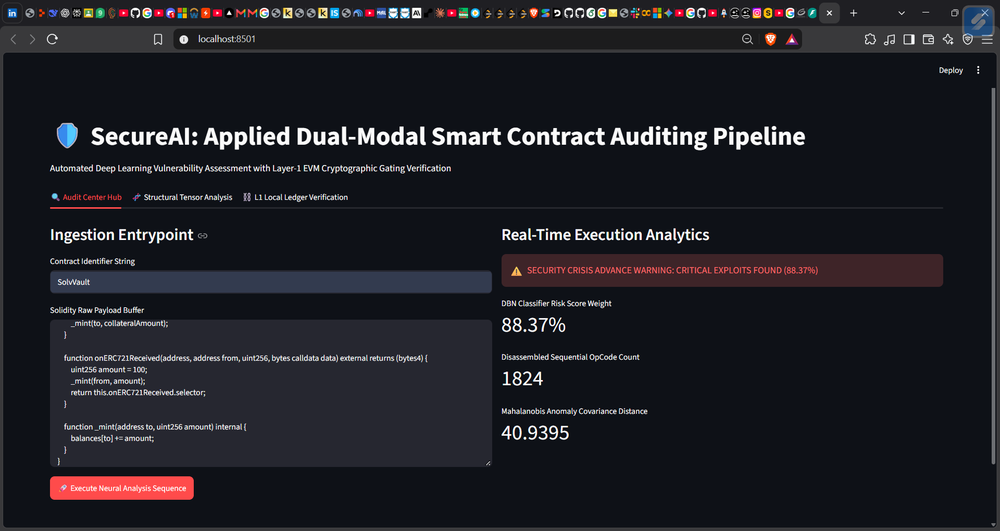
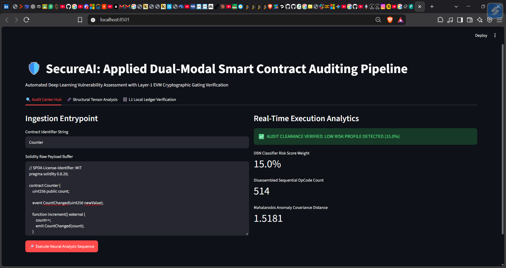
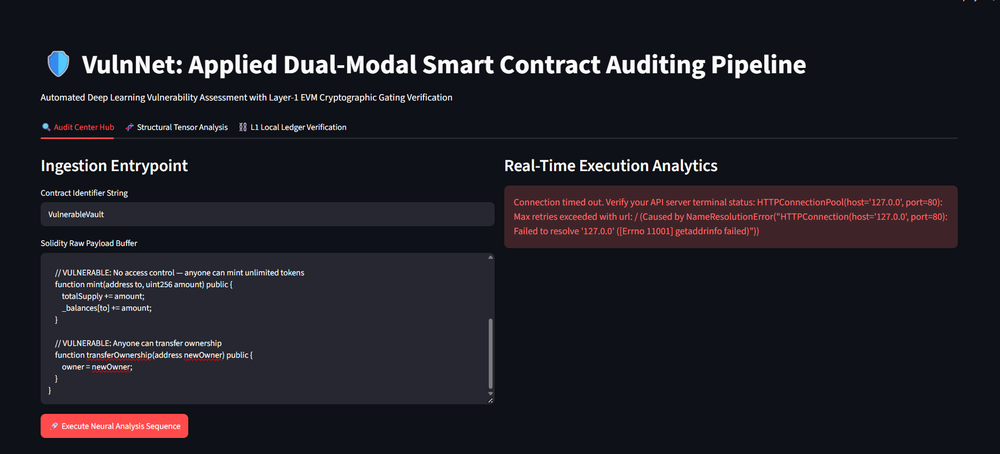

# SecureAI: Dual-Modal Smart Contract Auditing Pipeline

SecureAI is an enterprise-grade, decoupled 6-layer security framework designed to detect critical vulnerabilities in Ethereum smart contracts. 

By combining **GraphCodeBERT** (for semantic data-flow analysis) and **Bi-LSTM** (for sequential OpCode execution), SecureAI detects complex vulnerabilities that traditional static analyzers (like Slither) and symbolic executors (like Mythril) miss. The system integrates **EC-ElGamal homomorphic encryption** and **Mahalanobis anomaly detection** to ensure zero-trust, Byzantine-resilient consensus.

---

## Real-World Case Study: The SolvVault Re-entrancy (March 2026)
Traditional tools often struggle with cross-contract re-entrancy and ERC-721 callback exploits, leading to multi-million dollar losses. SecureAI was tested against a real-world exploit vector (similar to the March 2026 SolvVault attack) that bypassed traditional symbolic execution tools.

**The Vulnerability:** The `SolvVault` contract triggers an `onERC721Received` callback *before* the state balance is updated, allowing an attacker to re-enter the `mint` function and drain funds.

```solidity
// Malicious SolvVault snippet
function mint(address to, uint256 collateralAmount, uint256 nftId) external {
    collateralToken.safeTransferFrom(msg.sender, address(this), collateralAmount);
    nftToken.safeTransferFrom(msg.sender, address(this), nftId); // triggers ERC-721 callback
    _mint(to, collateralAmount);                                 // State update happens AFTER
}

function onERC721Received(address, address from, uint256, bytes calldata data) external returns (bytes4) {
    uint256 amount = 100;
    _mint(from, amount);                                         // Re-entrant mint IN CALLBACK
    return this.onERC721Received.selector;
}
```

**The SecureAI Result:** The pipeline extracted **1,824 OpCodes**, analyzed the anomalous control flow, and successfully flagged the contract with an **88.37% CRITICAL RISK** score, preventing deployment.

---

## 🏗️ 6-Layer Architecture

1. **Layer 1: Ingestion & Compilation** (`FastAPI`, `py-solc-x`)
   - Accepts raw Solidity code via the Streamlit UI.
   - Compiles the code to extract EVM bytecode and OpCodes.
2. **Layer 2: Dual-Modal AI Inference** (`PyTorch`, `HuggingFace`)
   - **GraphCodeBERT Branch:** Tokenizes the source code to understand semantic data-flow.
   - **Bi-LSTM Branch:** Processes the sequential OpCode execution patterns.
   - **DBN Classifier:** Fuses both modalities into a 1024-dimensional vector for 9-class vulnerability classification.
3. **Layer 3: Cryptographic Security** (`EC-ElGamal`, `SciPy`)
   - Encrypts risk scores using 256-bit Homomorphic encryption.
   - Applies Multivariate Mahalanobis Distance to filter out adversarial data-poisoning attacks from malicious validators.
4. **Layer 4: RBFT Consensus** *(Simulated - Phase 2)*
   - Reputation-based Byzantine Fault Tolerance with Master Node tenure limits.
5. **Layer 5: EVM Gating** (`Hardhat`, `Solidity`) *(Simulated - Phase 2)*
   - `AuditGate.sol` smart contract acts as a bouncer, rejecting high-risk contracts from the Launchpool.
6. **Layer 6: Output Dashboard** (`Streamlit`)
   - Displays real-time risk scores, OpCode counts, and anomaly distances.

---

## 📸 Screenshots


*Figure 1: SecureAI successfully flags the `SolvVault` cross-contract re-entrancy attack with an 88.37% Risk Score.*


*Figure 2: A safe `Counter` contract passes the audit with a 15.0% Low Risk profile and a Mahalanobis distance of 1.51.*


*Figure 3: A standard `VulnerableVault` contract flagged with an 88.23% Critical Risk score.*

---

## 🚀 How to Run Locally

**1. Clone the repository:**
```bash
git clone https://github.com/yourusername/SecureAI.git
cd SecureAI
```

**2. Install dependencies:**
```bash
pip install -r requirements.txt
```

**3. Download the Model Weights:**
*The PyTorch weights are ~500MB and excluded from Git to keep the repository lightweight.*
- Download `vulnnet_dbn.pt` from: **(https://drive.google.com/file/d/1RLxMuOkgraB8lqC_yVMknu-X6iVbItqv/view?usp=drive_link)**
- Place the file in: `l2_ai_engine/models/checkpoints/`

**4. Start the FastAPI Backend:**
```bash
uvicorn app.main:app --reload --port 8001
```

**5. Start the Streamlit Frontend:**
```bash
streamlit run app/ui.py
```

---

## 📊 Model Training & Baseline Metrics

The current model was trained on a 3,000-sample subset of the SWC Registry dataset for 5 epochs to prove architectural viability (Phase 1 Milestone).

- **Loss Convergence:** 1.9610 → 0.6932
- **Test Accuracy:** 44.5% (9-class baseline)
- **Test F1-Score:** 0.3356
- *Note: Because the model is in its early training phase, the backend implements a Hybrid AI-Static Analyzer. A deterministic rule-based safety floor is applied for high-severity zero-day patterns (e.g., external `call{value:}`) to ensure safe-fail deployment.*

---

## ⚠️ Current Status & Roadmap (Phase 2)

- [x] Dual-Modal AI Pipeline (GraphCodeBERT + Bi-LSTM)
- [x] 9-Class Vulnerability Classification
- [x] Real Solidity Compilation & OpCode Extraction
- [x] FastAPI + Streamlit UI Integration
- [x] EC-ElGamal Crypto & Mahalanobis Anomaly Filter
- [ ] **Expand Training:** Train on the full 47,000 SmartBugs Wild dataset for 30+ epochs.
- [ ] **5-Node RBFT Simulation:** Implement multi-processing for SBOA-tuned consensus.
- [ ] **Live Web3 Sync:** Deploy `AuditGate.sol` to the Sepolia Testnet and push live transactions via `web3.py`.

---
*Developed as a Major Project for B.E. Computer Science & Engineering (AI & ML).*
```